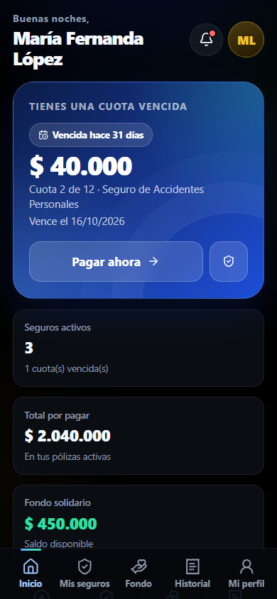
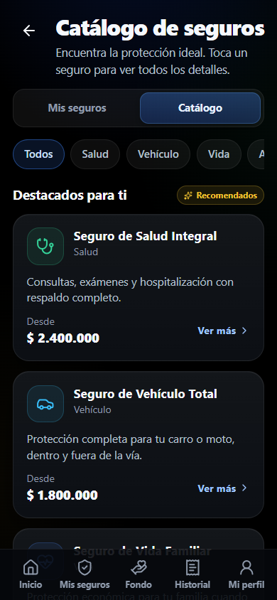
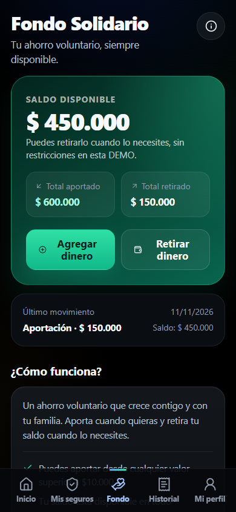
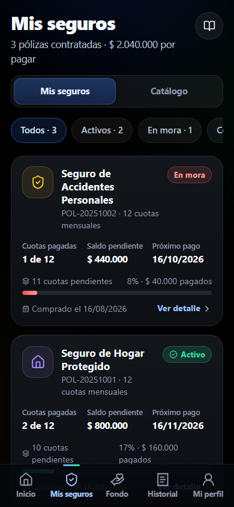
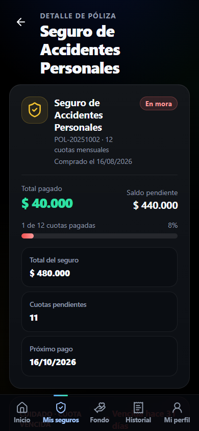
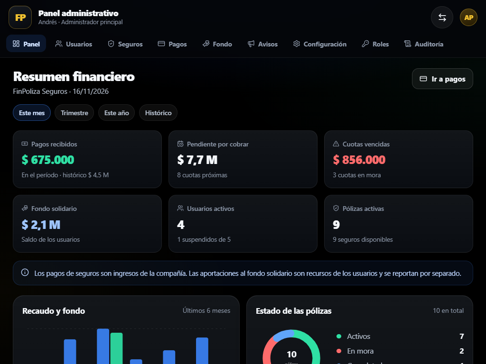

# FinPoliza · DEMO de app móvil de seguros y contabilidad

Aplicación móvil **funcional y navegable** para una compañía de seguros: catálogo y compra de
pólizas, control de cuotas, pagos simulados, fondo solidario, historial financiero y un panel
administrativo completo con roles, configuración global y auditoría.

> **DEMO:** todos los datos y operaciones son ficticios. No se mueven pagos reales ni se
> solicitan datos bancarios.

| Inicio | Catálogo | Fondo solidario |
|---|---|---|
|  |  |  |

| Mis seguros | Detalle y cuotas | Panel administrativo |
|---|---|---|
|  |  |  |

## Lo que incluye

- **Clientes:** inicio con resumen y próximo pago, catálogo, compra guiada, pólizas, calendario
  de cuotas, pago simulado con comprobante, fondo solidario (aportar/retirar), movimientos con
  filtros, perfil editable, notificaciones, ayuda y ajuste de tamaño de texto.
- **Administración:** dashboard contable con gráficos, usuarios (crear/editar/suspender/
  resetear contraseña/roles), seguros (precios, modalidades, coberturas, disponibilidad),
  pagos y cartera, fondo consolidado con ajustes justificados, configuración global de
  empresa/textos/moneda/funcionalidades, roles y permisos, avisos y auditoría.
- **Persistencia real** en IndexedDB, operaciones financieras atómicas, snapshot de pólizas,
  saldos calculados desde movimientos y sesión persistente.
- **Diseño AMOLED** premium, responsive (320 px → tablet), accesible para adultos mayores,
  con teclado, safe areas y escalado de texto.
- **Android** (Capacitor), APK firmada disponible en Releases.

## Inicio rápido

```bash
npm install
npm run dev      # desarrollo en http://localhost:5173
npm run build    # build de producción
```

### Android

Requiere JDK 21 y Android SDK 36.

```bash
npm run build
npx cap sync android
cd android
./gradlew assembleDebug "-Dorg.gradle.java.home=<ruta-jdk-21>"
adb install -r app/build/outputs/apk/debug/app-debug.apk
```

La APK firmada de la versión 1.0.0 está en
[Releases](https://github.com/andrespar2/FinPoliza/releases).

## Credenciales de demostración

| Perfil | Correo | Contraseña |
|---|---|---|
| Cliente (María) | `maria@demo.com` | `Demo123*` |
| Administrador principal | `admin@finpoliza.com` | `Admin123*` |
| Administrador | `gerencia@finpoliza.com` | `Admin123*` |
| Personal administrativo | `asesor@finpoliza.com` | `Asesor123*` |

Más cuentas y detalles en **[DEMO_CREDENTIALS.md](DEMO_CREDENTIALS.md)**.

## Documentación técnica

Toda la arquitectura, modelo de datos, reglas contables, diseño, pruebas y limitaciones está
en **[AGENTS.md](AGENTS.md)**. Ese archivo debe mantenerse actualizado con cada cambio.

## Stack

React 19 · TypeScript · Vite · React Router · IndexedDB · Capacitor 8 · Android nativo.
Sin backend: la demo funciona 100 % local.

## Licencia / uso

Proyecto de demostración desarrollado para presentación comercial. Los datos, marcas y
coberturas son ficticios.
